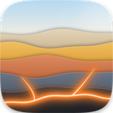
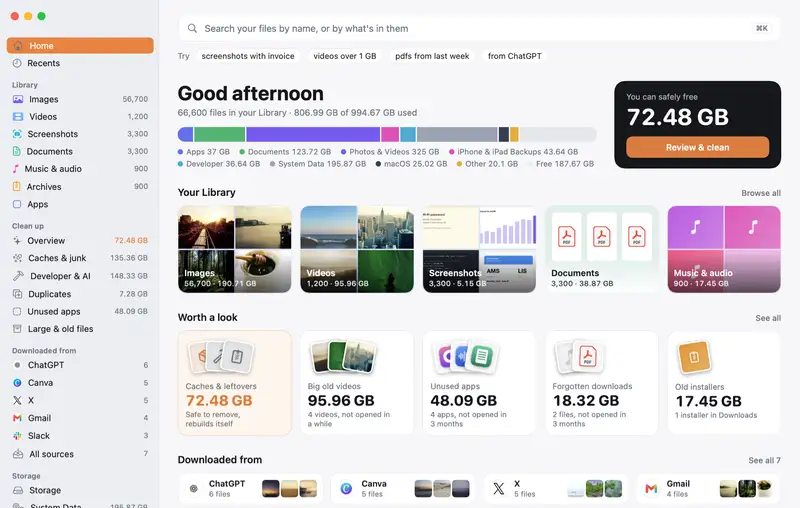
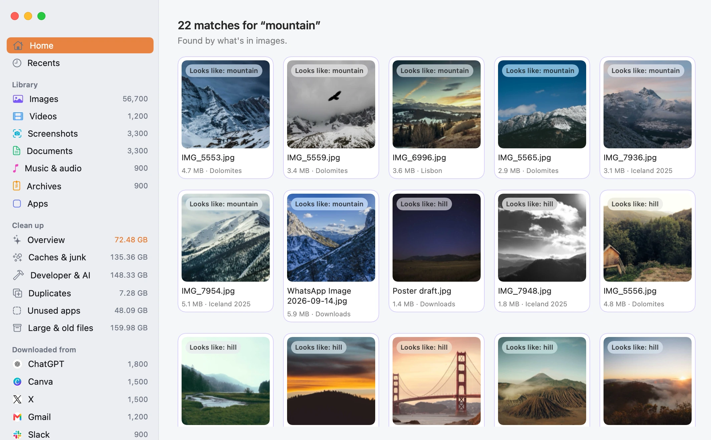
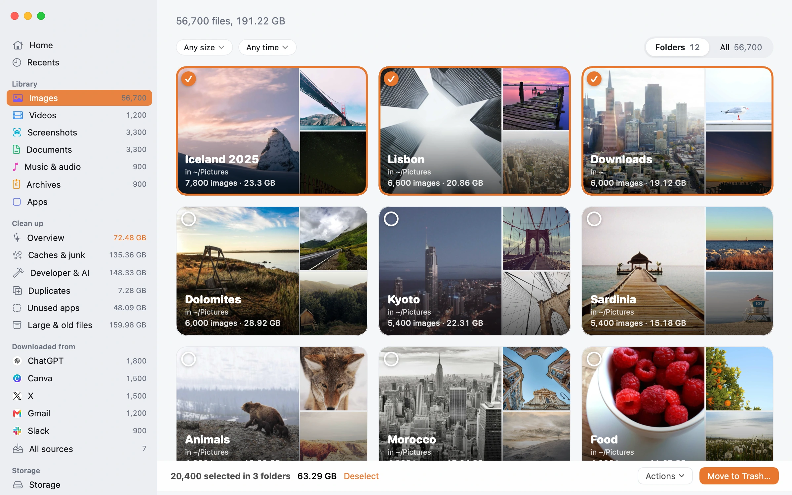
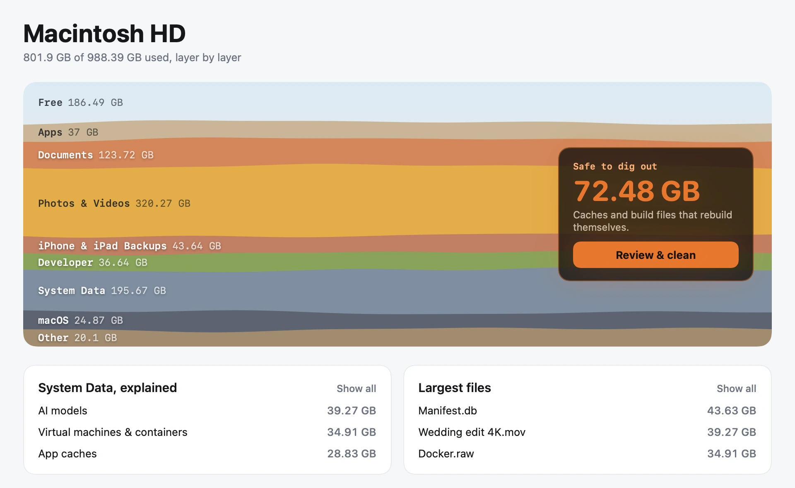
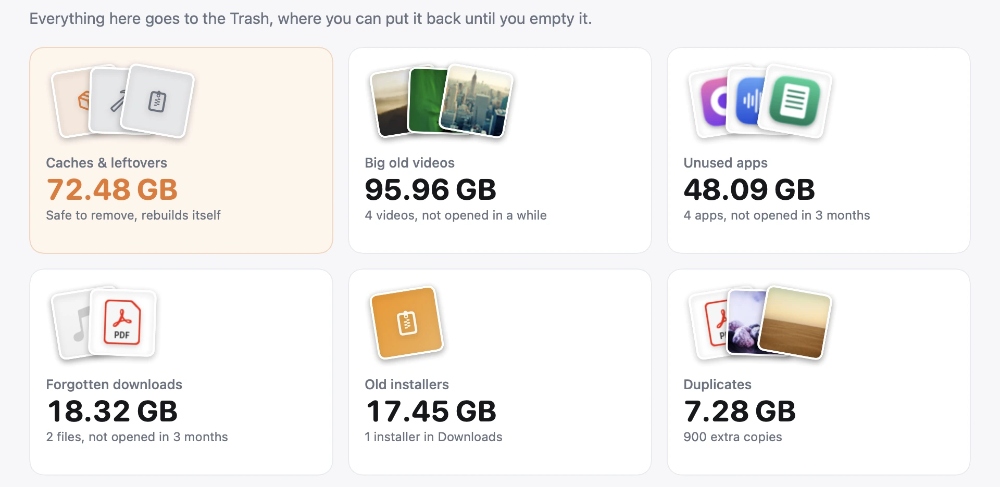
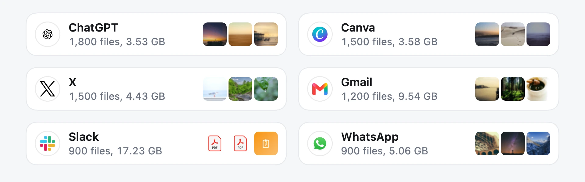

<p align="center"></p>

<h1 align="center">Unearth</h1>

<p align="center"><strong>Find anything. Free up the rest.</strong><br>
The free Mac app that shows what's filling your disk and helps you clear it.<br>
Nothing ever leaves your Mac.</p>

<p align="center"><a href="https://github.com/ekimakes/unearth/releases/latest/download/Unearth.dmg"><strong>Download for Mac</strong></a> · <a href="https://ekimakes.github.io/unearth/">Website</a> · Requires macOS 15 or later</p>



## Search inside your photos

Find any picture by what's in it, by the words in it, or by name, in plain language: `screenshots with invoice`, `pdfs from last week`, `from canva`. Every result says why it came up.



## Clear whole folders

A folder of 50,000 images opens as an overview by date, folder or download source. Tick as many as you like and move them to the Trash together.



## See where your space went

Your disk, drawn as layers of earth. System Data is split into named parts, and whatever can't be identified is shown as Not identified. A Disk Map opens into any folder.



## Clean up without worry

Duplicates, look-alike photos, forgotten downloads, old installers, old screenshots, big old videos, and unused apps with their leftovers. For developers: Xcode build files, package caches, simulators and local AI models, by name.

Every item says what it is, whether it will come back, and whether it's safe to remove. Unearth moves files to the Trash, with Undo. The few cleanups that run a developer tool's own command say so first.



## Find your downloads

Everything you saved from ChatGPT, Canva, X, Gmail, Slack and more, sorted by where it came from.



## Privacy

Unearth never connects to the internet.

- No analytics, crash reporting or accounts
- No update checks
- No remote config
- No third-party SDKs

Your index and thumbnails stay on your disk, and **Settings › Privacy › Forget everything** deletes them. A CI check fails the build if networking APIs appear in the source, and the code is here for anyone to read.

Full Disk Access is optional. It lets Unearth measure Mail, Messages and iPhone backups. Without it, Unearth still works and some space shows as Not identified.

## Build it yourself

You need Xcode 26 and macOS 26.

```bash
swift test --package-path Packages/UnearthKit
```

```bash
xcodebuild -project Unearth.xcodeproj -scheme Unearth -configuration Debug -derivedDataPath build/DerivedData CODE_SIGNING_ALLOWED=NO build
```

The app lands in `build/DerivedData/Build/Products/Debug/`. Published builds are made with `scripts/release.sh`, which signs and notarizes them.

## License

[GPL-3.0](LICENSE). Anyone distributing a modified version has to publish its source, which keeps the privacy promise checkable in forks too.

Company logos in `Unearth/Assets.xcassets/Logos` belong to their owners and aren't covered by this license. Unearth shows them only to say where a file was downloaded from. They come from the [logos](https://github.com/gilbarbara/logos), [Simple Icons](https://github.com/simple-icons/simple-icons) and [SVGL](https://github.com/pheralb/svgl) collections, and Unearth isn't affiliated with these companies.

The screens show a made-up sample Mac, with free photos from [Unsplash](https://unsplash.com/license).
