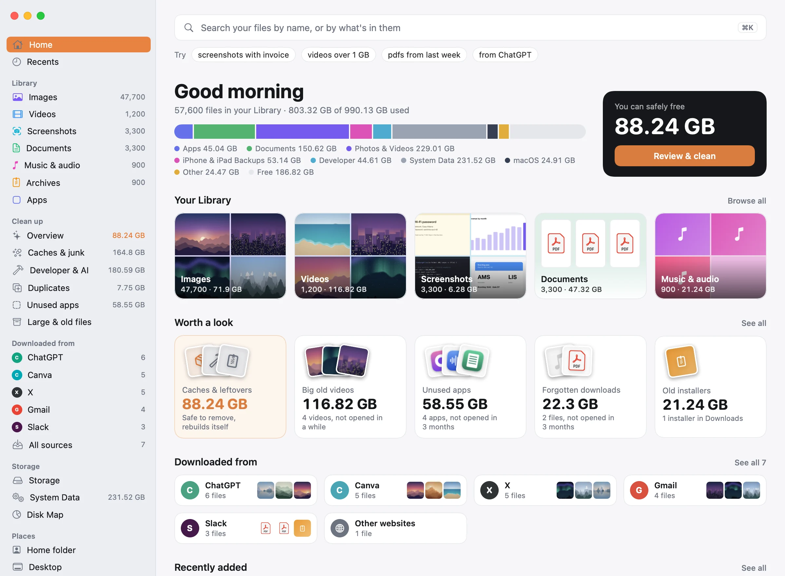

# Unearth

**Find anything. Free up the rest.**

Unearth is a free Mac app that shows what's filling your disk, clears it out safely, and finds any picture by what's in it. Nothing ever leaves your Mac.

[Download for Mac](https://github.com/ekimakes/unearth/releases/latest/download/Unearth.dmg) · [Website](https://ekimakes.github.io/unearth/) · Requires macOS 26 or later



## What it does

- **See where the space went.** Your disk, drawn as layers of earth. System Data is split into named parts, and whatever can't be identified is shown as Not identified. A Disk Map opens into any folder.
- **Clean without fear.** Duplicates, look-alike photos, forgotten downloads, old installers, old screenshots, big old videos, and unused apps with their leftovers. Every item says what it is, whether it will come back, and whether it's safe to remove.
- **Find anything.** Search by name, by the words inside a picture, or by what's in it, in plain language: `screenshots with invoice`, `pdfs from last week`, `from canva`. Every result says why it came up.
- **Handle big libraries.** A folder of 50,000 images opens as an overview by date, folder or download source, with a rail to jump anywhere.
- **Go deeper for developers.** Xcode build files, package caches, simulators and local AI models, by name.

Unearth moves files to the Trash, with Undo. The few cleanups that run a developer tool's own command say so first.

## Privacy

Unearth never connects to the internet.

- No analytics, crash reporting or accounts
- No update checks
- No remote config
- No third-party SDKs

Your index and thumbnails stay on your disk, and **Settings › Privacy › Forget everything** deletes them. A CI check fails the build if networking APIs appear in the source, and the code is here for anyone to read.

Full Disk Access is optional. It lets Unearth measure Mail, Messages and iPhone backups. Without it, Unearth still works and some space shows as Not identified.

## Build it yourself

You need Xcode 26 and macOS 26.

```bash
swift test --package-path Packages/UnearthKit
```

```bash
xcodebuild -project Unearth.xcodeproj -scheme Unearth -configuration Debug -derivedDataPath build/DerivedData CODE_SIGNING_ALLOWED=NO build
```

The app lands in `build/DerivedData/Build/Products/Debug/`. Published builds are made with `scripts/release.sh`, which signs and notarizes them.

## License

[GPL-3.0](LICENSE). Anyone distributing a modified version has to publish its source, which keeps the privacy promise checkable in forks too.
